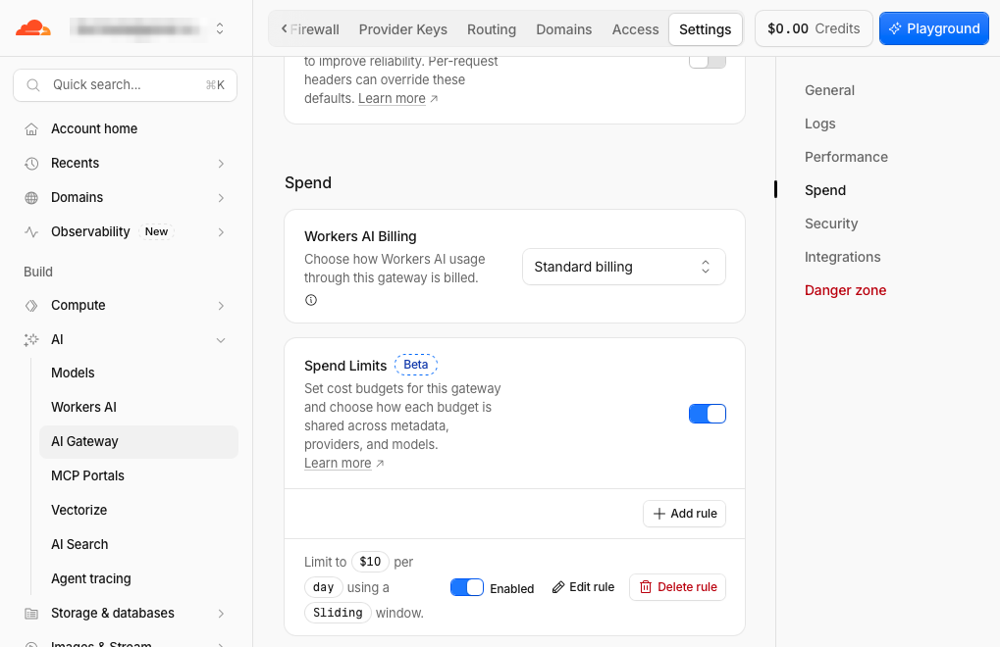

### A million side projects, not enough time to deploy any perfectly

Now that Opus 5.5 is producing more lines of code at a high enough quality per minute than us professional software engineers could produce per week, it's time we focus on how we can actually make our side projects functional. There are many potential barriers to this, but the most obvious one is time: if only we could dedicate a day per week to the side project.

I'll skip the discussion on deployment automation, on cloud hosting, security, fear of setting your project loose on the world, etc. We'll focus on a single constraint for building agents that can run locally on our laptops to do useful things: having access to an inference API. I mean we already pay a subscription fee to Anthropic, OpenAI or Google to use their coding agents, do we really need to pay more to use their API in code?

Annoyingly, we do. Other barriers to entry include the worry that we may unwittingly expose our API key or run up the bill too quickly! Also, we can't stop *them* from doing *things* with our data. Never mind running claude code atop vast directories on our personal machines.. but hey, maybe I am making poor assumptions & we don't do that.

There is an option available from the internet do everything company, Cloudflare, that may meet our needs. They offer 10,000 free neurons of LLM usage as part of their Workers AI inference product per account per day for anyone that signs up. How exciting, one would think, if only it were obvious what a neuron was.

### 10,000 Neurons a day, translated

A Neuron is Cloudflare's abstraction for a unit of GPU compute. Said Neuron is worth various amounts of input & output tokens per model; where some models, as one would expect, are costlier than others.

Cloudflare also doesn't offer every model it hosts as part of its free plan, frontier level models require payment. However, there are many capable open-weight models that can perform agentic use cases well, of which, I've selected 4 from well known Chinese labs to use in our Neurotic price comparison. Why these models? They're currently either the most advanced or the only free tier model available from Cloudflare that are produced by some of the premier non American AI labs.

The 10,000 neuron budget is translated below into either all input tokens or all output tokens.

| Model                          | Input tokens | Output tokens |
| ------------------------------ | ------------ | ------------- |
| `qwen3-30b-a3b-fp8`            | 2.16M        | 328K          |
| `glm-4.7-flash`                | 1.82M        | 275K          |
| `deepseek-r1-distill-qwen-32b` | 221K         | 23K           |
| `qwen3.8-27b`                  | 244K         | 34K           |

It's pretty impossible to use only input or output tokens. We'll compare three common use cases of inference in action and translate what one free day of your neuron budget provides.

| Use Case                                      | Tokens per run    | QWEN3-30B-A3B | GLM-4.7-FLASH | QWEN3.8-27B  | DEEPSEEK-R1-DISTILL |
| --------------------------------------------- | ----------------- | ------------- | ------------- | ------------ | ------------------- |
| Summarize a 12 page article or paper          | 12K in / 700 out  | 130 articles  | 109 articles  | 14 articles  | 11 articles         |
| Extract data from a 5-page PDF                | 4.5K in / 600 out | 255 pdfs      | 214 pdfs      | 27 pdfs      | 21 pdfs             |
| Review a 5,000-line AI generated pull request | 65K in / 2K out   | 27 PR reviews | 23 PR reviews | 3 PR reviews | 2 PR reviews        |

### Why are some models more expensive than others?

TL;DR: The short answer is the cost of compute of running each model.

If you'll entertain a bit of a longer answer: the model architecture used to build the model impacts the amount of compute used to process input tokens & calculate output tokens. One major difference between the models compared above is how many of the model's parameters are used to calculate an output token, given all input tokens.

The four models follow two patterns: Mixture of Experts (MoE) or dense.

A MoE model has many parameters but uses only a subset of them to generate each output token. A dense model uses all of its parameters to generate every output token. So a MoE model with 100B total params & 10B active params means that per output token, 10B params are used to calculate it. A dense model with 27B total params uses all 27B params for every output token, which is 2.7x more computationally intensive (roughly, ignoring lots of other factors) than the MoE model.

Since Cloudflare's pricing charges per neuron: using dense models will consume your balance quicker. The computational cost of generating a token is not equivalent, dense models require more compute per token, and the neuron abstraction is what accounts for this.

I would also like to touch on the `Reasoning` setting that is available to most "thinking" models today. When enabled, models will generate intermediary tokens from the input, prior to providing a final output to the caller. Reasoning tokens are billed as output tokens, because, well, they are: each reasoning token is generated as output from the initial input. These reasoning tokens are then used as new input, which requires further compute, to generate additional output tokens. This can repeat for a bit until the model is satisfied & produces a final answer.

This obviously consumes your neuron budget quicker.

### I just don't want American or Chinese corporations to capture my data

Well me neither, but that's pretty hard to accomplish nowadays if one participates in digital society. That said, I prefer to choose to trust Cloudflare, if I'm given a choice. From their [Data Usage](https://developers.cloudflare.com/workers-ai/platform/data-usage/#our-commitments-for-customer-content) page:

> **No training:** Cloudflare does not use Customer Content processed by Workers AI to train AI models.

Cloudflare also mentions on that page that they have a zero data retention policy for data processed by inference & that they do not create or train the models available through the Workers AI product.

### Great, I want to take advantage of this!

That's wonderful, dear reader. The first thing you'll need is a Cloudflare account. Assuming you have that (or consider this pause for you to create a free one, otherwise), you can enable the Workers AI inference product by following Cloudflare's [helpful instructions](https://developers.cloudflare.com/workers-ai/get-started/rest-api/).

Generate your API key & put a limit on spend. This limit can be set to $0, just after the free tier use expires.

The spend limit is set on the AI Gateway product, which appears right beneath the "Workers AI" option in your Cloudflare account. All inference requests go through a default AI gateway, so you'll be able to navigate into the default one & set the spend limit in the settings option.


<p align="center"><em>Setting a spend limit on the default AI Gateway</em></p>

Add it to your code & try it out! Here is Cloudflare's example curl, or set it as an environment variable & have your coding agent reference it during runtime.

```bash
curl https://api.cloudflare.com/client/v4/accounts/$CLOUDFLARE_ACCOUNT_ID/ai/run/@cf/qwen/qwen3.8-27b \
  -X POST \
  -H "Authorization: Bearer $CLOUDFLARE_AUTH_TOKEN" \
  -d '{ "messages": [{ "role": "system", "content": "You are a friendly assistant" }, { "role": "user", "content": "Tell me about yourself!" }]}'
```

Now your side project can run locally as a server, long running process or scheduled job, do your bidding, all whilst costing you no additional dollars & not exposing your data to *them*.
